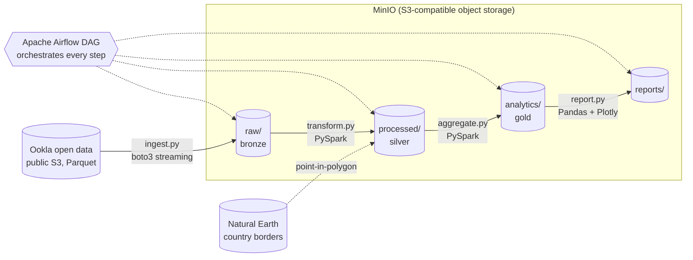

# Mobile Network Performance Benchmark

A batch data pipeline that benchmarks **mobile network performance** (download speed, upload
speed, latency) across **Central and Eastern Europe**, using Ookla's public, anonymized
speed-test data. Hungary is highlighted.

**Stack:** Python 3.12 · PySpark · Pandas · Apache Airflow · MinIO (S3-compatible) · Plotly ·
Docker Compose · pytest · GitHub Actions

## Architecture



| Layer | Location | Content |
|---|---|---|
| Raw (bronze) | `raw/ookla/type=mobile/year=…/quarter=…/` | Untouched copy of the Ookla quarterly Parquet files |
| Processed (silver) | `processed/ookla_mobile_tiles/year=…/quarter=…/` | Valid tiles only, speeds in Mbps, country assigned |
| Analytics (gold) | `analytics/country_quarter_kpis/` | Test-weighted KPIs and rankings per country and quarter |
| Reports | `reports/benchmark_report.html` | Interactive benchmark report |

### Design decisions

- **Weighted averages.** Ookla publishes one average per ~600 m tile. Country averages are
  weighted by the number of tests per tile, so a tile with one test does not count as much
  as a tile with hundreds.
- **Exact country assignment.** Tile centres are matched to Natural Earth country polygons
  with a vectorized point-in-polygon test (`mapInPandas` + shapely), after a cheap
  bounding-box pre-filter.
- **Idempotent steps.** Ingestion skips files already present; Spark writes use dynamic
  partition overwrite, so re-running a quarter replaces only that quarter.
- **Thin DAG, fat package.** The DAG only wires tasks; all logic lives in the `netbench`
  package and is unit-tested without Airflow.
- **Config from the environment.** No secrets in code: `.env` (git-ignored) holds the real
  values, `.env.example` documents them.

## Project structure

```
dags/network_benchmark.py     Airflow DAG (wiring only)
src/netbench/
  config.py                   typed settings from environment variables
  storage.py                  S3/MinIO helpers (idempotent bucket creation)
  ingest.py                   Ookla public bucket -> raw
  geo.py                      country borders and point-in-polygon lookup
  spark.py                    SparkSession with S3A configured for MinIO
  transform.py                raw -> processed (PySpark)
  aggregate.py                processed -> analytics (PySpark)
  report.py                   analytics -> HTML report (Pandas + Plotly)
tests/                        pytest unit tests (moto for S3, local Spark)
docker/airflow/Dockerfile     Airflow image with Java + the netbench package
docker-compose.yml            MinIO, Postgres and Airflow
.github/workflows/ci.yml      lint + tests on every push
```

## Run it

Requirements: Docker Desktop (8 GB memory), Python 3.12, Java 17+ (for local Spark).

```bash
cp .env.example .env            # then set S3_ACCESS_KEY and S3_SECRET_KEY
docker compose up -d --build    # MinIO, Postgres, Airflow
```

- Airflow UI: http://localhost:8080 → trigger the `network_benchmark` DAG
- MinIO console: http://localhost:9001
- The report appears in the `reports` bucket (`benchmark_report.html`)

### Run the steps locally (without Airflow)

```bash
python -m venv .venv && source .venv/bin/activate
pip install -e ".[dev]"
set -a; source .env; set +a

python -m netbench.storage
python -m netbench.ingest --year 2026 --quarter 3
python -m netbench.transform
python -m netbench.aggregate
python -m netbench.report        # writes data/reports/benchmark_report.html
```

### Tests and linting

```bash
pytest -v
ruff check . && ruff format --check .
```

## Data attribution

Speedtest® by Ookla® Global Fixed and Mobile Network Performance Maps. Based on analysis by
Ookla of Speedtest Intelligence® data. Provided by Ookla and accessed via the
[Registry of Open Data on AWS](https://registry.opendata.aws/speedtest-global-performance).
Ookla trademarks used under license and reprinted with permission.
Country boundaries: [Natural Earth](https://www.naturalearthdata.com/) (public domain).
